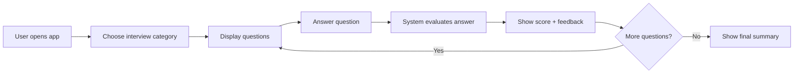
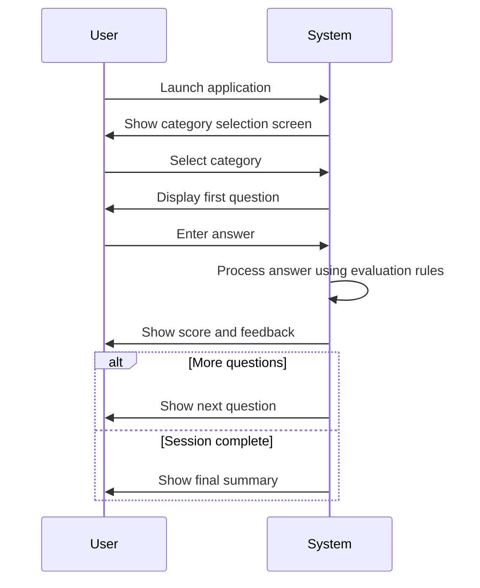
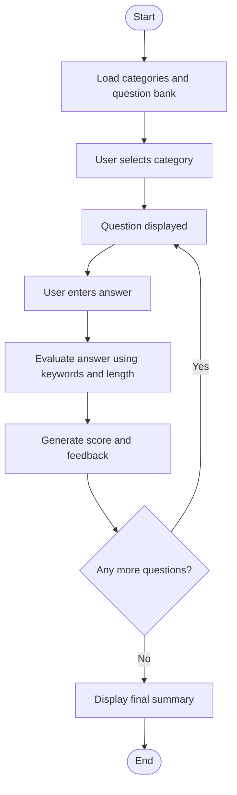
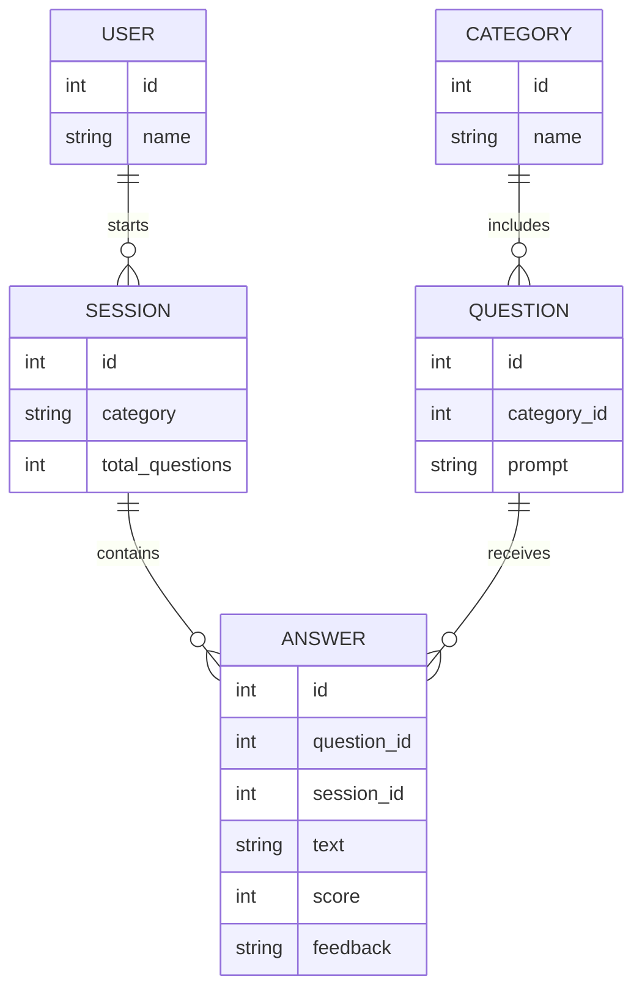
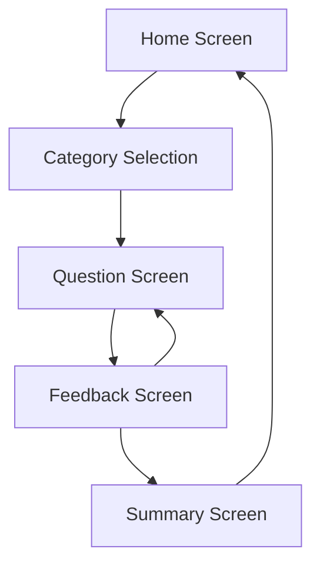

# Updated FYP Design Document

Date: 2026-10-04
Project: AI-Powered Interview Preparation Assistant

## 1. Project Status and Submission Focus

This document updates the previous requirement specification and aligns the project with the FYP submission schedule in the academic calendar. The project is currently in the design and prototype stage, and the next target submission date is October 5, 2026.

The milestone expected at this stage includes:

- R&D and requirements refinement
- use-case documentation
- conceptual interface design
- project plan revision
- minimum working prototype
- ERD / data model concept

---

## 2. Updated System Overview

The AI Interview Preparation Assistant is a desktop-based application designed to help students and job seekers practice interview questions in a structured way. The system presents a selected interview category, asks relevant questions, accepts text-based answers, analyzes them, and provides score-based feedback.

### Core objectives

1. Help users practice technical and behavioral interviews.
2. Make interview preparation interactive and focused.
3. Provide immediate feedback for answer quality.
4. Reduce the need for manual evaluation by using simple NLP-inspired scoring.
5. Keep the project feasible for an academic final-year project.

---

## 3. Functional Requirements

### 3.1 User story

As a user, I want to choose a category and practice interview questions so that I can improve my confidence and communication skills.

### 3.2 Functional requirements

1. The system shall allow the user to select an interview category.
2. The system shall display interview questions relevant to the selected category.
3. The system shall accept text input for each answer.
4. The system shall evaluate the answer using keyword-based relevance and quality scoring.
5. The system shall provide feedback and a score after each answer.
6. The system shall show a final summary after the session ends.
7. The system shall support a small set of categories in the initial version.

---

## 4. Use Cases

### Main use cases

- UC-01: Select interview category
- UC-02: View interview questions
- UC-03: Enter answer
- UC-04: Analyze answer
- UC-05: Receive feedback
- UC-06: End session and review summary

### Use-case description example

| Use Case ID | Name | Actor | Description |
|---|---|---|---|
| UC-01 | Select category | User | User chooses a relevant interview category. |
| UC-02 | View questions | User | System displays questions from the selected category. |
| UC-03 | Answer question | User | User types a detailed answer to the interview question. |
| UC-04 | Evaluate answer | System | System checks keywords, detail level, and structure. |
| UC-05 | Show feedback | System | System shows score and constructive feedback. |
| UC-06 | Review summary | User | User sees combined results and performance summary. |



```mermaid
usecaseDiagram
    actor User
    rectangle "Interview Preparation Assistant" {
        usecase "Select Category"
        usecase "Answer Question"
        usecase "Evaluate Response"
        usecase "View Feedback"
        usecase "Review Summary"
    }
    User --> "Select Category"
    User --> "Answer Question"
    "Answer Question" --> "Evaluate Response"
    "Evaluate Response" --> "View Feedback"
    "View Feedback" --> "Review Summary"
```

---

## 5. Flow of the System

### 5.1 Main application flow



### 5.2 Prototype logic flow



---

## 6. Conceptual Data Model / ERD

The initial version does not require a complex database, but the conceptual structure can be modeled as follows:



---

## 7. Conceptual GUI Layout

### 7.1 Main screens

1. Home screen
   - project title
   - category dropdown
   - start interview button

2. Interview screen
   - question prompt
   - input area for answer
   - submit button

3. Feedback screen
   - score
   - short explanation
   - next question button

4. Summary screen
   - overall score
   - per-question result list
   - retry or exit option

### 7.2 Simple navigation concept



---

## 8. Non-Functional Requirements

1. The application should be lightweight and easy to run on a standard desktop machine.
2. The interface should be simple and user-friendly.
3. The system should respond quickly for a small number of questions.
4. The code should be maintainable and understandable for academic evaluation.
5. The project should avoid unnecessary personal data collection.

---

## 9. Prototype Implementation Status

The prototype in this folder implements the main flow:

- category selection
- question display
- answer input
- evaluation logic
- score and feedback
- summary screen

This corresponds directly to the requirement specification and the current FYP design milestone.

---

## 10. Next Actions

For the upcoming submission, the following tasks should be completed:

1. Finalize the use-case documentation and diagram.
2. Include conceptual GUI mockups in the document.
3. Add the ERD/data model in the design section.
4. Briefly describe the evaluation logic used by the prototype.
5. Update the project plan with the next milestones.
6. Package the design document and prototype together before submission.

---

## 11. Conclusion

The project has progressed beyond basic project planning and is now in the implementation/design support stage. The updated design document and prototype together validate that the system can satisfy the core requirements while staying within the scope of an academic final-year project.
